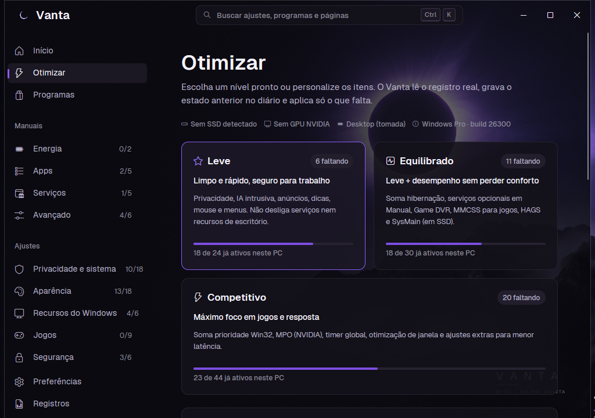
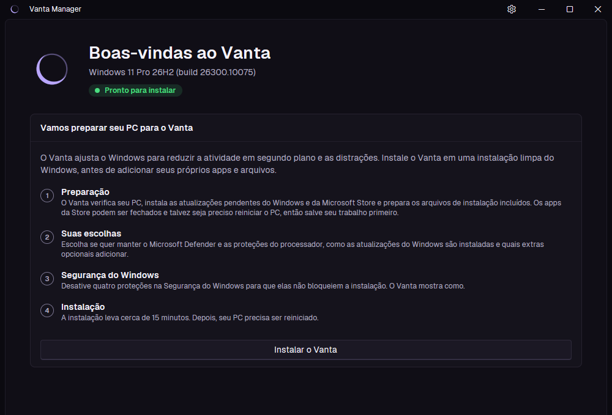
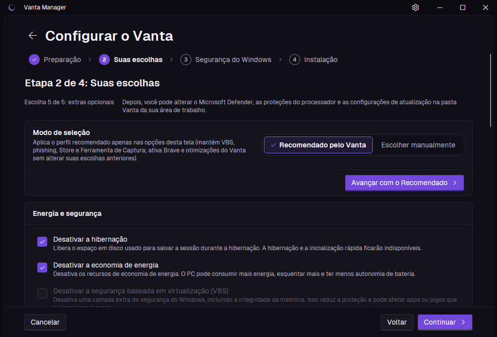
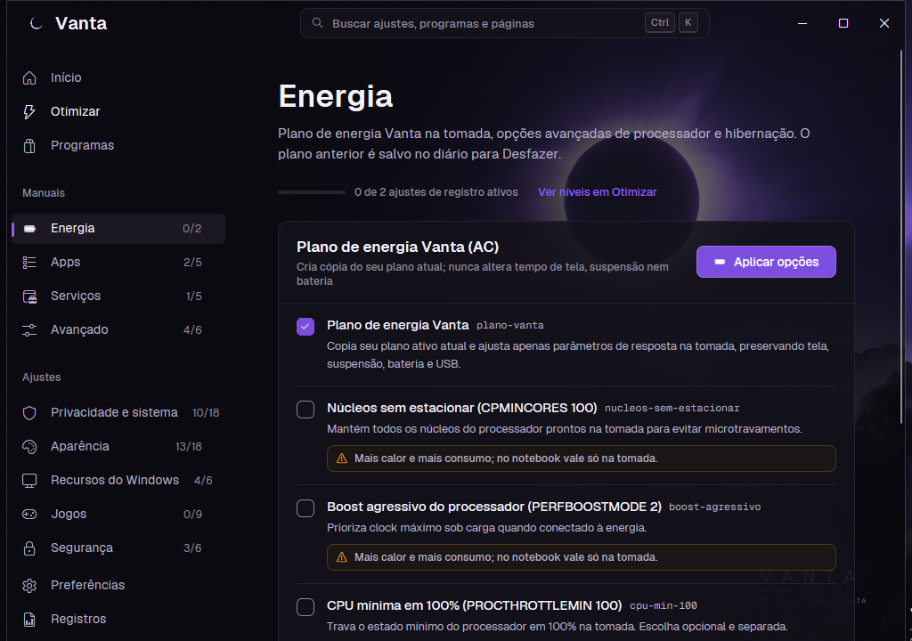
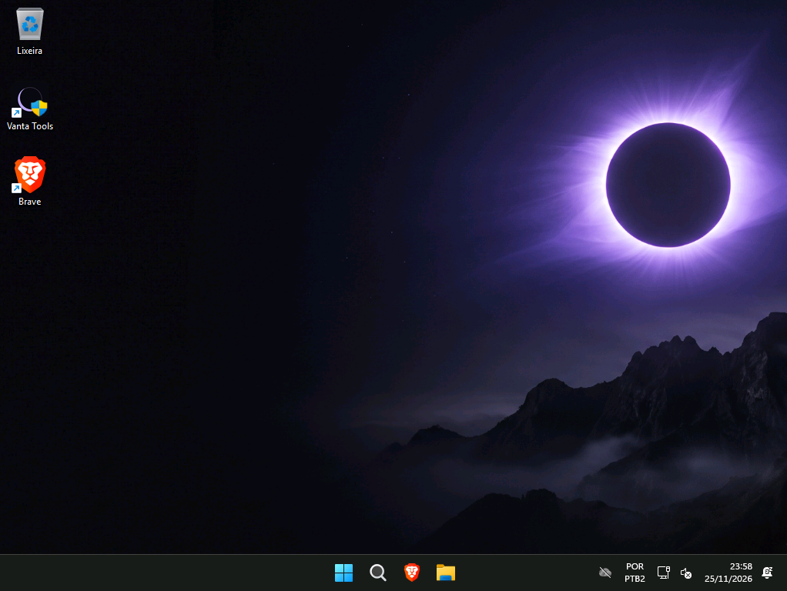

<div align="center">


# Vanta

**Modificação aberta, leve e auditável para Windows 11 — foco em desempenho, privacidade, segurança por padrão e visual coeso.**

[](https://github.com/spaayy/vanta/releases/tag/v1.0.0)
[](LICENSE)
[](docs/windows-release-policy.md#supported-releases)
[](app/)

[Baixar v1.0.0](https://github.com/spaayy/vanta/releases/latest) · [Galeria](#galeria) · [Destaques](#destaques) · [Instalação](#instalação) · [Colaboradores](#colaboradores) · [Licença](#licença-e-código-fonte)

<br />



</div>

---

O **Vanta** é software livre sob a **GNU GPL-3.0**: você pode usar, estudar, modificar e redistribuir — inclusive comercialmente — mantendo o código-fonte e os avisos de licença junto com cada cópia.

## Destaques

- **Níveis de otimização em 1 clique + `Personalizado`:** no **Vanta Tools**, escolha entre **Leve** (privacidade, IA intrusiva e anúncios sem mexer em serviços), **Equilibrado** (desempenho sem perder conforto) e **Competitivo** (foco em resposta e jogos). Desmarcar qualquer item ativa o modo **Personalizado** com persistência local, leitura real do registro, seção recolhida **"Já feito pelo Vanta"** e **Desfazer** via diário (`niveis.json`).
- **Controles manuais transparentes:** abas dedicadas para **Energia** (cria cópia do seu plano ativo preservando tempo de tela, suspensão, bateria e USB), **Apps** (remove/reinstala no usuário atual sem tocar na Microsoft Store nem no App Installer), **Serviços** (controle individual de inicialização com restauração ao padrão) e **Avançado** (dispositivos PnP 100% opt-in com bloqueio de hardware crítico como TPM, vídeo, rede, disco e portas seriais).
- **Segurança e apps de trabalho preservados por padrão:** Microsoft Defender, SmartScreen, mitigações de CPU e Isolamento de Núcleo (VBS/HVCI) ficam **ativos por padrão** (com trava explícita para jogos que exigem anti-cheat como Valorant/Vanguard). Apps e fluxos de trabalho — Microsoft Store, Ferramenta de Captura, Paint, Câmera, Relógio, Notas Autoadesivas, To Do, Assistência Rápida, Outlook, Teams, OneDrive, notificações do Windows e UAC em tela escura — são preservados.
- **Visual Vanta e papéis de parede 2K assinados:** tema escuro nativo, destaque `#7C4EE0`, barra de tarefas centralizada e 3 papéis de parede 2K (`2560×1440`) oficiais (**01 · Torii Névoa**, **02 · Pico Nebulosa** e **03 · Eclipse Violeta**), com bases sem assinatura e composição reprodutível documentados em [`PROVENANCE.md`](PROVENANCE.md).
- **Executável único e integridade verificável (`SHA256SUMS`):** o `VantaManager.exe` já embute o pacote `.vantapkg` (não precisa de arquivo separado nem de internet para abrir) e cada release publica `SHA256SUMS`, `Vanta-<versão>-source.zip`, `Vanta-<versão>-third-party-sources.zip` e `licenses.zip`.

## Galeria

| Vanta Manager — Boas-vindas | Vanta Manager — Perfil Recomendado |
| :---: | :---: |
|  |  |
| **Vanta Tools — Energia (Controles Manuais)** | **Visual Vanta — Área de Trabalho** |
|  |  |

## Instalação

Baixe o `VantaManager.exe` na [última release](https://github.com/spaayy/vanta/releases/latest) e execute-o como administrador. O pacote do Vanta já vai embutido no executável: não precisa baixar nenhum outro arquivo nem ter conexão para abrir.

1. Siga a etapa **Preparação**: o Vanta verifica o PC, atualiza o Windows e os apps da Store e prepara os arquivos incluídos.
2. Em **Suas escolhas**, selecione **Recomendado pelo Vanta** ou **Escolher manualmente** nas cinco decisões de instalação e avance até concluir.
3. Após reiniciar, use o **Vanta Tools** (atalho na área de trabalho) para aplicar níveis, ajustar opções manuais, desfazer alterações pelo diário ou instalar programas.

O Vanta requer uma edição e versão suportadas do Windows 11 (veja [versões suportadas do Windows](docs/windows-release-policy.md#supported-releases)).

### Verificação, VirusTotal e SmartScreen

Antes de executar, confira a integridade do `VantaManager.exe` com o `SHA256SUMS` da release (no PowerShell ou no Prompt de Comando):

```powershell
# PowerShell
Get-FileHash .\VantaManager.exe -Algorithm SHA256
Get-Content .\SHA256SUMS
```

```cmd
:: Prompt de Comando (CMD)
certutil -hashfile VantaManager.exe SHA256
```

- **VirusTotal (`v1.0.0`):** você pode consultar o SHA-256 oficial do `VantaManager.exe` (`c4880b7dea2ca19e3ed1811403c6835867cd72e5c52f545cb25fb84928da0421`) diretamente em [virustotal.com/gui/file/c4880b7d…0421](https://www.virustotal.com/gui/file/c4880b7dea2ca19e3ed1811403c6835867cd72e5c52f545cb25fb84928da0421) — se o arquivo ainda não constar na base pública, qualquer pessoa pode enviar o próprio executável ao VirusTotal para conferir os motores de antivírus de forma independente.
- **Aviso do Windows SmartScreen ("O Windows protegeu o computador" / editor desconhecido):** o Vanta é um projeto independente e aberto que ainda não possui certificado pago de assinatura de código (EV/OV), por isso o SmartScreen pode exibir esse aviso em executáveis novos. Em vez de pedir confiança cega, o projeto é 100% open-source (GPL-3.0), publica o `SHA256SUMS` verificável e distribui o código-fonte completo em `Vanta-1.0.0-source.zip` para auditoria ou compilação local (`cargo build --locked`).

## O que o Vanta ajusta

| Área | O que o Vanta faz | Saiba mais |
| --- | --- | --- |
| **Privacidade** | Desliga telemetria selecionada do Windows e aplica políticas que reduzem coleta de dados. | [Catálogo de ajustes](docs/catalog/tweaks.md#privacy) |
| **Desempenho** | Reduz atividade em segundo plano e ajusta serviços e energia preservando tela, suspensão e bateria. | [Política de energia](docs/power-saving-policy.md), [Política de serviços](docs/services-startup-policy.md) |
| **Segurança** | Permite escolher como Microsoft Defender, SmartScreen, Windows Update, mitigações de CPU e Isolamento de Núcleo ficam configurados. Tudo permanece protegido por padrão. | [Ajustes de instalação](docs/catalog/tweaks.md) |
| **Usabilidade** | Aplica o Visual Vanta (tema escuro, `#7C4EE0`, papéis de parede 2K), remove anúncios do Windows e preserva apps de trabalho. | [Catálogo de alternâncias](docs/catalog/toggles.md) |

Configurações de privacidade do seu navegador e de outros aplicativos permanecem exatamente como você definiu. Os resultados de desempenho variam conforme o hardware e a carga de trabalho.

## Audite o que o Vanta faz

- O pacote do Vanta (`.vantapkg`) é um arquivo ZIP protegido por senha (`vantapkg`) composto majoritariamente por PowerShell e dados legíveis; veja o [formato do pacote](docs/package-format.md).
- O [inventário de binários](package/Executables/VantaModules/README.md) lista cada executável do pacote, sua origem e licença.
- O [catálogo de alternâncias](docs/catalog/toggles.md) e o [catálogo de ajustes de instalação](docs/catalog/tweaks.md) documentam todas as chaves e opções.
- O código-fonte completo do [Vanta Manager e Vanta Tools](app/) está neste repositório em Rust + GPUI.
- A origem, licenças e reprodutibilidade das artes 2K estão documentadas em [`PROVENANCE.md`](PROVENANCE.md).

## Colaboradores

O Vanta foi idealizado e conduzido por **Nathan Souza** em colaboração com múltiplos modelos de IA e orquestração multiagente:

| Colaborador | Papel no projeto |
| --- | --- |
| **Nathan Souza** ([@spaayy](https://github.com/spaayy)) | Criador do Vanta, direção de produto, identidade visual e decisões finais de escopo |
| **Claude** *(Anthropic)* | Arquitetura, revisão de contratos, auditoria técnica/segurança e implementação assistida |
| **Gemini** *(Google)* | Design de interface (UI/UX em Rust + GPUI), sistema visual, artes 2K e refinamento visual |
| **GPT** *(OpenAI)* | Engenharia, scripts de sistema, empacotamento, testes automatizados e validação de QA |
| **OpenBot** | Orquestração multiagente e automação do fluxo de desenvolvimento e verificação |

Quer contribuir? Comece pelo [guia de contribuição](.github/CONTRIBUTING.md), pela [documentação para desenvolvedores](docs/README.md) e pelo [guia do Vanta Manager](app/README.md).

## Licença e código-fonte

O Vanta é software livre licenciado sob a [GNU General Public License v3.0](LICENSE).
Você pode usar, copiar, modificar e distribuir — inclusive comercialmente — nos termos dessa licença. O texto da licença e o arquivo [NOTICE](NOTICE) devem acompanhar todas as cópias.

Toda release disponibiliza o código-fonte correspondente completo no mesmo local dos binários, sem custo adicional (GPL-3.0 seção 6(d)):

- `Vanta-<versão>-source.zip` — árvore pública completa do código-fonte (este repositório, a partir da versão 1.0.0);
- `Vanta-<versão>-third-party-sources.zip` — código-fonte dos programas GPL transportados no pacote que não foram escritos pelo Vanta (`ViVe v0.3.3` e `Multi-Choice` no commit licenciado, com `vendor/` para compilação offline).

Este repositório contém a mesma árvore de código-fonte, incluindo o [Vanta Manager / Vanta Tools](app/) e o [pacote](package/). Os avisos de terceiros do app estão em [`app/licenses/README.md`](app/licenses/README.md).

O Vanta **não** inclui o Windows e **não** altera a ativação do Windows. Você precisa da sua própria cópia e licença do Windows.

## Créditos

- **AtlasOS**: o Vanta é baseado no AtlasOS 0.6.0 (<https://github.com/Atlas-OS/Atlas>), copyright dos contribuidores do AtlasOS, sob a GPL-3.0. O crédito ao Atlas faz parte da licença e permanece em toda cópia.
- **sxsc**: o ferramental de empacotamento de componentes Windows (CABs) está descrito em [`tools/sxsc`](tools/sxsc/README.md); as configurações são próprias do Vanta.
- **Geist e Geist Mono**: fontes da interface, por Vercel, sob a SIL Open Font License 1.1 (<https://github.com/vercel/geist-font>); o aviso completo está em [`app/licenses/fonts/Geist-OFL.txt`](app/licenses/fonts/Geist-OFL.txt).
- **Artes-base dos papéis de parede**: geradas com Google Flow; seleção, composição, tipografia e acabamento pelo projeto Vanta (detalhes e script reprodutível em [`PROVENANCE.md`](PROVENANCE.md) e [`NOTICE`](NOTICE)).
- **Código e programas de terceiros**: as crates Rust do Vanta Manager e Vanta Tools estão listadas com suas licenças em [`THIRD-PARTY-NOTICES.txt`](app/licenses/THIRD-PARTY-NOTICES.txt), e os executáveis do pacote no [inventário de binários](package/Executables/VantaModules/README.md). Cada componente mantém sua própria licença e copyright.

Atlas e os demais nomes citados pertencem aos seus respectivos proprietários. O Vanta não é afiliado nem endossado por eles.

## Segurança, rede e privacidade

O Vanta não envia telemetria própria e não exige conta. Ele acessa a rede apenas quando você solicita:

- Windows Update, Microsoft Store e `winget` baixam atualizações e programas exatamente como fazem sem o Vanta.
- O Vanta consulta `api.github.com` para informações públicas: manifestos do catálogo `winget` (`microsoft/winget-pkgs`), a versão mais recente do `winget` e o instalador do Vencord em `github.com` apenas quando você marca essa opção. São requisições anônimas somente leitura; nenhum dado pessoal é enviado além do que qualquer requisição HTTPS carrega (seu endereço IP).
- O Vanta Manager só baixa um pacote do Vanta quando você pede explicitamente.

Nada mais é enviado para lugar algum.

**Pacotes de manutenção do Windows (CBS).** Remover o Microsoft Defender e os componentes de telemetria exige dois pacotes de serviço (CABs) assinados de forma aceita pelo Windows. O Windows recusou a única identidade com a qual o Vanta pode assinar honestamente (`CN=Vanta CBS Packages` autoassinado, erro `0x800b0110`), e o Vanta nunca ativa modo de teste (`test signing`) nem desativa verificação de assinatura. Portanto:

- **A edição pública (`VantaManager.exe`, com pacote embutido) não carrega nenhum CAB.** Ela não oferece remoção do Defender (que permanece ativo, escolha recomendada), enquanto as políticas e ajustes de registro de telemetria continuam aplicados; apenas o CAB de telemetria fica fora.
- O código-fonte público (`source.zip`) não carrega nenhum CAB nem assinante que cite a Microsoft.
